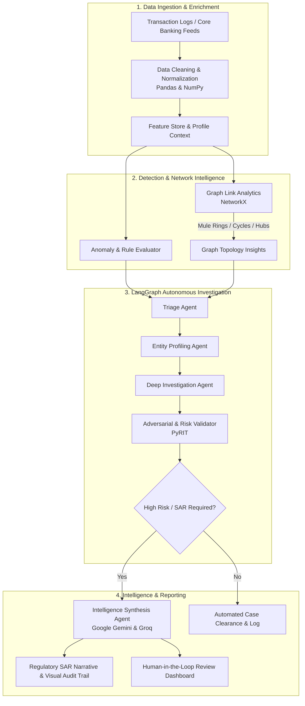

# 🛡️ AI-Assisted Detection, Investigation & Intelligence

> **Azentio Hackathon** | Intelligent Multi-Agent Financial Crime Detection, Graph Link Analysis, and Automated Investigation Platform for BFSI.

---

## 📌 Overview

Financial institutions face unprecedented volumes of complex transaction data, organized mule rings, sophisticated money laundering schemes, and strict regulatory reporting deadlines. Traditional rule-based engines produce high rates of false positives, overburdening compliance analysts.

**AI-Assisted Detection, Investigation & Intelligence** is an end-to-end multi-agent framework designed to automate and augment the AML (Anti-Money Laundering), fraud detection, and suspicious activity investigation lifecycle:

1. **Detection**: Rapid anomaly scoring, transaction pattern screening, and adversarial risk evaluation.
2. **Investigation**: Multi-agent investigation orchestrated via **LangGraph**, correlating KYC data, transaction histories, and behavioral deviations.
3. **Intelligence**: Graph-based entity resolution and link analysis powered by **NetworkX** to uncover hidden syndicate structures, circular fund routing, and mule networks, culminating in automated, audit-ready **Suspicious Activity Reports (SAR)** generated by high-performance LLMs (**Google GenAI & Groq**).

---

## 🏛️ System Architecture



---

## ✨ Key Capabilities

- **Autonomous Agent Workflows (LangGraph)**:
  Stateful, cyclic multi-agent graph coordinating specialized agents (Triage, Profiling, Investigation, and Compliance) with checkpoints and human-in-the-loop review.
- **Entity Link Analysis (NetworkX)**:
  Constructs and inspects complex financial interaction graphs. Identifies:
  - Circular routing and layering topologies.
  - High-betweenness mule accounts acting as transaction bridges.
  - Clustered communities of illicit actors.
- **Dual-Engine LLM Intelligence**:
  - **Groq (Llama 3)**: Ultra-low-latency real-time triage, entity classification, and immediate alert enrichment.
  - **Google GenAI (Gemini)**: Deep contextual reasoning across massive transaction logs, complex evidence aggregation, and regulatory narrative drafting.
- **AI Safety & Adversarial Risk (PyRIT)**:
  Continuous evaluation against prompt injection, evasion attempts, and data contamination risks within automated compliance workflows.

---

## 🛠️ Tech Stack

| Category | Technology | Purpose |
| :--- | :--- | :--- |
| **Agent Orchestration** | [LangGraph](https://github.com/langchain-ai/langgraph), [LangChain](https://github.com/langchain-ai/langchain) | Stateful multi-agent graph workflows & tool use |
| **LLM Inference** | [Google GenAI](https://ai.google.dev/) (`gemini-1.5/2.0`), [Groq](https://groq.com/) | Deep reasoning, long-context analysis & ultra-fast triage |
| **Graph Intelligence** | [NetworkX](https://networkx.org/) | Complex network analysis, cycle detection, centrality scoring |
| **Data Processing** | [Pandas](https://pandas.pydata.org/), [NumPy](https://numpy.org/) | High-speed data manipulation and feature engineering |
| **AI Risk & Red-Teaming** | [PyRIT](https://github.com/Azure/PyRIT) | AI risk identification and defensive validation |
| **Environment & Package Mgmt** | [uv](https://docs.astral.sh/uv/), Python 3.11+ / 3.13 | High-speed package resolution and deterministic virtual environments |

---

## 📂 Project Structure

```text
Azentio-hackathon/
├── AI_Assisted_Detection-Investigation-Intelligence/
│   ├── src/
│   │   ├── agents/            # LangGraph multi-agent state definitions & nodes
│   │   ├── graph/             # NetworkX topology builders & cycle algorithms
│   │   ├── detection/         # Scoring algorithms & anomaly detectors
│   │   ├── intelligence/      # SAR narrative generators & report synthesis
│   │   └── utils/             # Data loaders and formatters
│   ├── tests/                 # Unit and agent evaluation test suites
│   ├── main.py                # Entrypoint orchestrator
│   ├── pyproject.toml         # uv project configuration
│   └── README.md
├── notebooks/                 # Jupyter exploration & prototype notebooks
├── data/                      # Synthetic transaction feeds & graph samples
├── requirements.txt           # Flat dependency specifications
├── .env.example               # Template environment configuration
└── README.md                  # Project documentation (this file)
```

---

## 🚀 Quickstart Guide

### 1. Prerequisites

- Python `>= 3.11` (or Python `3.13`)
- [`uv`](https://docs.astral.sh/uv/) installed (recommended) or standard `pip`

### 2. Installation

Clone the repository and install dependencies:

```bash
# Using uv (fastest)
uv sync

# Or using standard pip
python -m venv .venv
# On Windows:
.venv\Scripts\activate
# On Linux/macOS:
source .venv/bin/activate

pip install -r requirements.txt
```

### 3. Environment Setup

Create a `.env` file in the root directory:

```env
# Google Gemini API
GOOGLE_API_KEY=your_gemini_api_key_here

# Groq API
GROQ_API_KEY=your_groq_api_key_here

# Optional: LangSmith Tracing
LANGCHAIN_TRACING_V2=false
LANGCHAIN_API_KEY=your_langsmith_api_key_here
```

### 4. Running the Platform

To run the main orchestration workflow:

```bash
# With uv
uv run python AI_Assisted_Detection-Investigation-Intelligence/main.py

# Or within activated virtualenv
python AI_Assisted_Detection-Investigation-Intelligence/main.py
```

---

## 🎯 Target Use Cases for Azentio BFSI

- **Anti-Money Laundering (AML)**: Automated detection of smurfing, structuring, and nested correspondent banking violations.
- **Transaction Fraud & Mule Accounts**: Real-time identification of hijacked accounts and rapid movement of unauthorized funds across accounts.
- **Trade-Based Financial Crime**: Cross-referencing trade invoices, shipping entities, and financial transfers.
- **Regulatory Reporting**: Reducing case investigation cycle time from hours to minutes with automated, verifiable audit trails and drafted SAR filings.

---

## 📄 License

This project is licensed under the terms described in the [LICENSE](LICENSE) file.